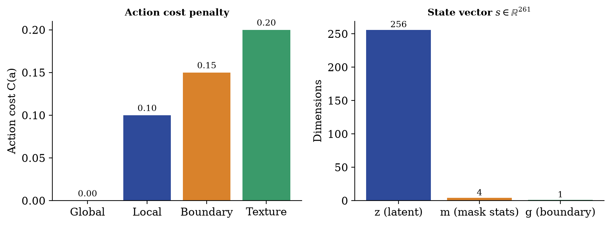
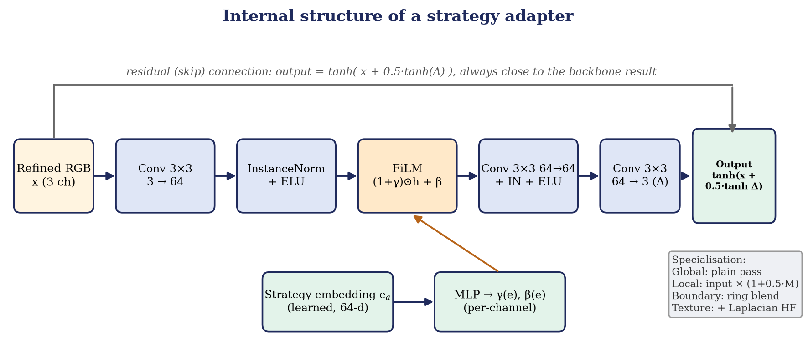

# Architecture

This page explains how a damaged image becomes a completed image, which components do the work, and where each one lives in the code.

## 1. End-to-end data flow


For one image (all tensors in the range [-1, 1], masks are 1 inside the hole):

1. **Input.** `masked_image` (3 channels, hole zeroed) and `mask` (1 channel), both 256×256.
2. **Coarse pass.** The frozen DeepFill-v2 Stage 1 predicts a coarse completion. The *coarse composite* is `masked_image + coarse * mask`.
3. **State.** The 96-channel bottleneck of the coarse stage, pooled and projected to 256 numbers, is joined with four mask statistics and one boundary-gradient value to form a **261-dimensional state**.
4. **Decision.** The PPO policy maps the state to one of four actions.
5. **Refine pass.** The frozen DeepFill-v2 Stage 2 (convolution branch plus contextual attention) refines the coarse composite into an RGB image.
6. **Adapter.** The adapter selected by the action post-processes that RGB image.
7. **Compose.** Only the hole region of the adapter output is written back: `completed = masked_image + adapted * mask`, i.e. `(1 − M) ⊙ I + M ⊙ adapted`.

## 2. The frozen backbone

`src/models/deepfillv2.py` wraps the PyTorch port of DeepFill-v2 (`src/models/networks_tf.py`) with Places2 weights.

* **Input.** Five channels: masked RGB, a plane of ones, and the mask.
* **Stage 1 (coarse).** Gated convolutions (`output = ELU(W_f * x) ⊙ sigmoid(W_g * x)`) with dilation rates up to 16.
* **Stage 2 (refine).** A convolutional branch and a contextual-attention branch, concatenated and decoded.
* **Frozen.** `RLInpaintingModel.load_pretrained_backbone` loads the weights, sets `requires_grad = False` and keeps the module in evaluation mode, so every improvement comes from the adapters and the controller.

The backbone exposes three methods used everywhere: `coarse_forward`, `refine_forward` and `get_bottleneck_feature`.

## 3. The state vector (261 numbers)



| Part | Size | How it is computed |
|---|:---:|---|
| Latent embedding *z* | 256 | Output of the last dilated layer of the coarse stage (96 channels) → global average pooling → `Linear → LayerNorm → ELU → Linear` (`src/models/encoder.py`) |
| Missing-area ratio | 1 | hole pixels / all pixels |
| Bounding-box ratio | 1 | area of the hole's bounding box / all pixels |
| Region count | 1 | connected components of the mask, divided by 10 and clipped to [0, 1] |
| Centroid distance | 1 | distance of the hole's centre of mass from the image centre, normalised by the half-diagonal |
| Boundary gradient *g* | 1 | mean Sobel gradient magnitude of the coarse composite on a one-pixel ring just outside the hole, divided by 2 and clipped to [0, 1] |

`src/rl/state.py` (`StateBuilder`) concatenates these into the observation. The latent comes from a forward pass the system performs anyway, so the state adds no extra backbone computation.

## 4. The four strategy adapters

`src/models/strategy_adapters.py` defines four small residual networks that all share the same skeleton.



* The adapter operates on the **RGB output of the refine stage**.
* Layers: `Conv(3→64) → InstanceNorm → ELU → FiLM → Conv(64→64) → InstanceNorm → ELU → Conv(64→3)`.
* **FiLM** (feature-wise linear modulation) scales and shifts the 64 hidden channels with `(1 + γ(e)) ⊙ h + β(e)`, where *e* is a learned 64-dimensional embedding of the strategy and `γ`, `β` come from a small MLP.
* The output is a bounded residual: `out = tanh(x + 0.5 · tanh(Δ))`, so adapters refine the backbone result rather than replace it.

| Action | Adapter | What it does before/around the shared block | Cost |
|:---:|---|---|:---:|
| 0 | Global | Plain pass, no mask weighting | 0.00 |
| 1 | Local | Multiplies the input by `1 + 0.5·mask`, emphasising the hole | 0.10 |
| 2 | Boundary | Builds a dilate-minus-erode ring (5×5) around the hole and blends the adapted output more strongly there | 0.15 |
| 3 | Texture | Adds a Laplacian high-pass term inside the hole and a small high-frequency branch | 0.20 |

The costs are hand-set penalties used by the reward; all four adapters have the same size. The complete adapter set (including the four strategy embeddings) is about 1.5 MB.

## 5. The unified model

`src/models/rl_inpainting_model.py` (`RLInpaintingModel`) joins the pieces:

| Method | Purpose |
|---|---|
| `coarse_forward(masked, mask)` | Stage 1 coarse prediction |
| `extract_state_embedding(masked, mask)` | The 256-d latent used in the state |
| `refine(coarse_composite, mask, strategy)` | Stage 2 + adapter. `strategy=None` returns the backbone-only result (the baseline); an integer 0–3 selects an adapter |
| `forward(masked, mask, strategy)` | Complete pass returning coarse, refined, completed and the state embedding |
| `load_pretrained_backbone`, `load_adapters` | Checkpoint loading |
| `freeze_adapters`, `unfreeze_adapters` | Switch adapter training on or off |

Every inference path (web app, evaluation, RL environment) goes through this class.

## 6. Code map

```text
src/
├── models/        deepfillv2.py, networks_tf.py (backbone) · encoder.py · strategy_adapters.py
│                  rl_inpainting_model.py (unified model) · discriminator.py · losses.py
├── rl/            state.py · actions.py · reward.py · env_bandit.py · env_multistep.py
├── training/      pretrain_adapters.py · train_rl_bandit.py · trainer_utils.py
├── data/          dataset.py · mask_generator.py · transforms.py (feathered blending)
├── evaluation/    metrics.py · severity_eval.py · evaluate.py
└── utils/         seed.py · logger.py
```

The earlier small from-scratch generator (`src/models/generator.py`) and the experiments built on it (`pretrain_gan.py`, `train_rl_ablations.py`, `joint_finetune.py`, `env_multistep.py`) are kept as a separate, earlier line of work.
