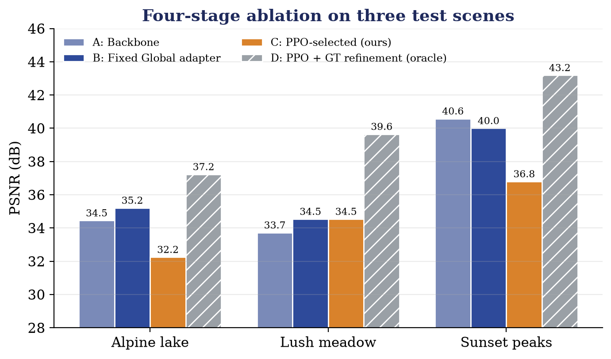
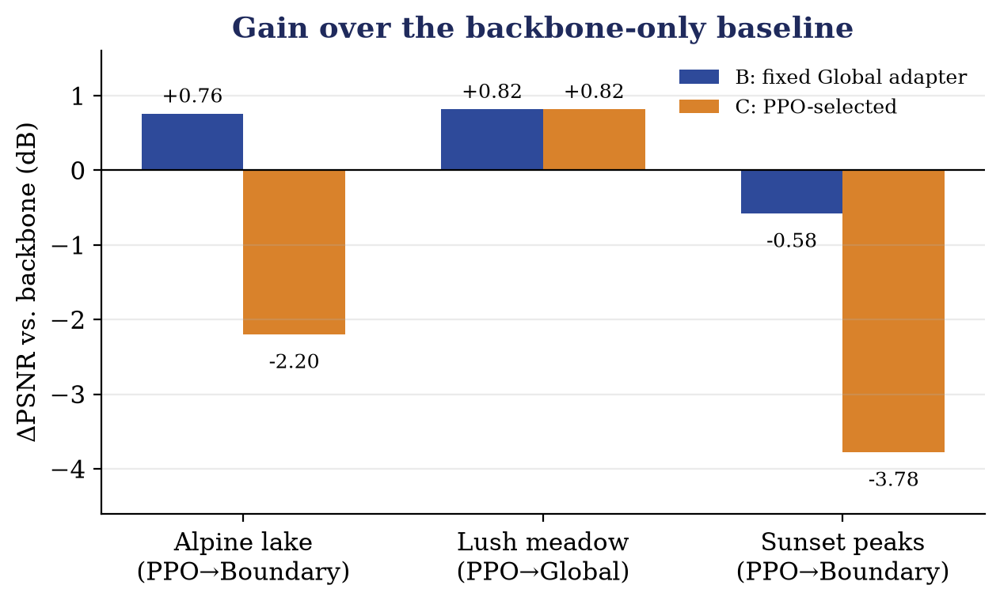
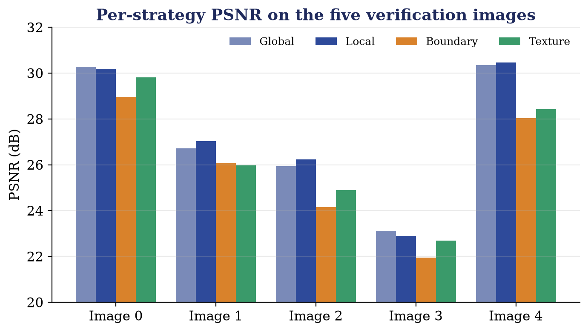
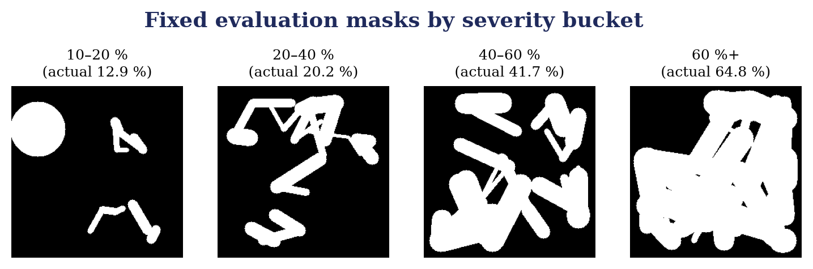

# Evaluation

This page explains how the system is evaluated, which metrics are used, and what the recorded results show.

## 1. Metrics

| Metric | Meaning |
|---|---|
| PSNR (dB) | Pixel-level fidelity; higher is better |
| SSIM | Structural similarity of luminance, contrast and structure; higher is better |
| LPIPS | Distance between deep VGG features, closer to human perception; lower is better |
| L1 / hole L1 | Mean absolute error over the whole image and inside the hole |

PSNR and SSIM are computed on the composited full image in the range [0, 1] (`src/rl/reward.py`, `src/evaluation/metrics.py`).

## 2. The four-stage ablation

`python scripts/run_multi_image_test.py`

| Stage | Configuration | Uses ground truth? |
|:---:|---|:---:|
| **A** | DeepFill-v2 backbone only (`strategy=None`) | No |
| **B** | Fixed Global adapter (action 0) | No |
| **C** | PPO picks the adapter; one forward pass | No |
| **D** | Stage C plus 400 AdamW steps on the test image (lr 1.5e-3 with cosine decay, hole-weighted L1 and an 8× gradient-matching loss against the target) | Yes |

Stages A–C are feed-forward measurements. Stage D shows how far the adapters can be pushed when they are optimised directly on a target image.

The script runs three test scenes (sample images 1, 2 and 5) with hand-designed masks and writes a seven-panel comparison per scene (ground truth, masked, coarse, A, B, C, D) plus `results/multi_image_evaluation_report.md`.

| Scene | PPO action | A: Backbone | B: Fixed Global | C: PPO-selected | D: Oracle |
|---|---|:---:|:---:|:---:|:---:|
| Alpine lake | 2 (Boundary) | 34.45 dB | 35.21 dB | 32.25 dB | 37.23 dB |
| Lush meadow | 0 (Global) | 33.72 dB | 34.54 dB | 34.54 dB | 39.65 dB |
| Sunset peaks | 2 (Boundary) | 40.58 dB | 40.00 dB | 36.80 dB | 43.19 dB |

Reading the table: the Global adapter (B) lifts PSNR by about 0.8 dB on two scenes; on the meadow the agent selected the Global adapter, so C equals B; and stage D reaches 37–43 dB, which shows the adapter structure has the capacity to represent a much closer solution.

## 3. Strategy verification

`python main.py verify-strategies` compares all four adapters on the same inputs. On the five verification images:

| Image | Global | Local | Boundary | Texture | Best |
|:---:|:---:|:---:|:---:|:---:|:---:|
| 0 | 30.28 | 30.18 | 28.97 | 29.82 | Global |
| 1 | 26.72 | 27.04 | 26.09 | 25.98 | Local |
| 2 | 25.94 | 26.23 | 24.16 | 24.90 | Local |
| 3 | 23.12 | 22.89 | 21.95 | 22.68 | Global |
| 4 | 30.35 | 30.46 | 28.04 | 28.42 | Local |
| Mean | 27.28 | 27.36 | 25.84 | 26.36 | – |

## 4. Backbone-only baseline (Experiment A)

`python main.py eval-baseline` evaluates the frozen backbone without adapters or RL. The recorded run (5 samples) gave PSNR 21.23 ± 1.82 dB, SSIM 0.864 ± 0.029, LPIPS 0.033 ± 0.014, L1 0.0566 and hole L1 0.4275.

## 5. Severity buckets

`python main.py create-eval-set` writes 100 fixed masks, 25 in each missing-area bucket, plus a manifest that pairs them with the first 100 images:

| Bucket | Missing area |
|---|---|
| 1 | 10–20 % |
| 2 | 20–40 % |
| 3 | 40–60 % |
| 4 | 60 % and above |

`src/evaluation/severity_eval.py` (`SeverityEvaluator`) groups test items by their missing ratio and reports baseline versus RL-guided PSNR/SSIM and the action counts per bucket; this is the tool for studying how adaptive control behaves as holes grow.

## 6. Outputs

| File | Content |
|---|---|
| `results/demo_image_*.png` | Seven-panel ablation comparisons |
| `results/multi_image_evaluation_report.md` | Ablation table and per-scene analysis |
| `results/baseline_test/` | Backbone baseline metrics (`baseline_metrics.json`, `baseline_report.md`) |
| `results/strategy_verify/` | Per-image strategy grids and `verify_results.json` |
