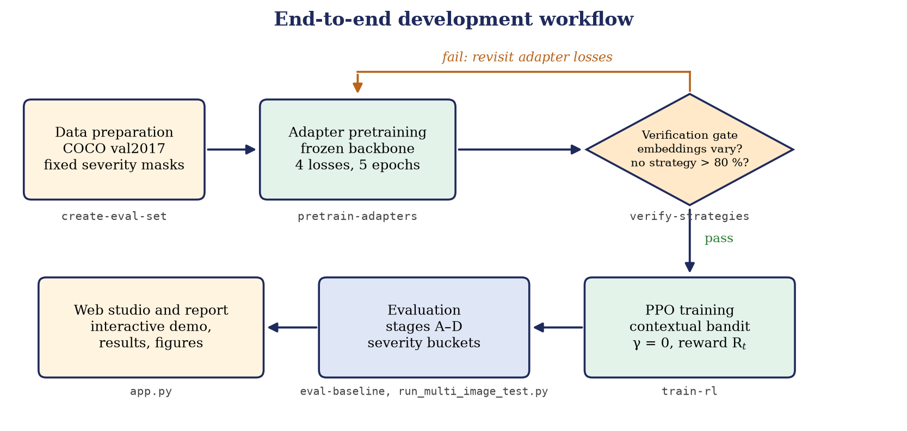

# Getting Started

This page lists everything needed to set up the project and run each stage of the pipeline.

## 1. Environment

The project runs on Python 3.10 or newer; it was developed with Python 3.12, PyTorch 2.6 and CUDA 12.4 on an NVIDIA RTX 3050.

```powershell
python -m venv .venv
.\.venv\Scripts\Activate.ps1          # Linux/macOS: source .venv/bin/activate
pip install -r requirements.txt       # or: uv sync
python -c "import torch; print(torch.__version__, torch.cuda.is_available())"
```

## 2. Downloads

| What | Command | Destination |
|---|---|---|
| DeepFill-v2 Places2 backbone (about 40 MB) | `python scripts/download_gan.py` (needs `gdown`) | `checkpoints/pretrained/deepfillv2_places2.pth` |
| COCO val2017 images (5,000 images) | `python scripts/download_coco.py` | `data/raw/val2017/` |

The adapter weights (`checkpoints/adapters/adapters_final.pt`) and the PPO policy (`checkpoints/rl_agent_bandit/ppo_bandit_final.zip`) are produced by the training commands below, or can be copied in from a finished run.

Expected checkpoint layout:

```text
checkpoints/
├── pretrained/deepfillv2_places2.pth
├── adapters/adapters_final.pt
└── rl_agent_bandit/ppo_bandit_final.zip
```

## 3. Run the pipeline

Every command is run from the repository root through `main.py`.

```powershell
# 1. Fixed evaluation masks (25 per severity bucket)
python main.py create-eval-set --image-dir data/raw/val2017 --output-dir data/masks/fixed_eval_masks --count 25 --image-size 256

# 2. Pretrain the four adapters (backbone frozen)
python main.py pretrain-adapters --config configs/pretrain_adapters.yaml

# 3. Check that the four strategies produce different outputs
python main.py verify-strategies --data-dir data/raw/sample_images --num-images 5 --output-dir results/strategy_verify

# 4. Train the PPO controller
python main.py train-rl --config configs/rl_agent_bandit.yaml --timesteps 10000

# 5. Evaluate
python main.py eval-baseline --data-dir data/raw/sample_images --mask-dir data/masks/fixed_eval_masks --samples 100
python scripts/run_multi_image_test.py

# 6. Interactive demo
python app.py
```

Open `http://localhost:7860` for the web studio. Run `python main.py -h` for the full list of sub-commands.



## 4. Where things are written

| Output | Location |
|---|---|
| Adapter checkpoints | `checkpoints/adapters/` |
| PPO policy | `checkpoints/rl_agent_bandit/` |
| TensorBoard logs | `logs/adapters/`, `logs/rl_agent_bandit/` (`tensorboard --logdir logs`) |
| Strategy verification grids and JSON | `results/strategy_verify/` |
| Backbone baseline metrics | `results/baseline_test/` |
| Ablation panels and report | `results/demo_image_*.png`, `results/multi_image_evaluation_report.md` |

## 5. Configuration

Hyper-parameters live in `configs/*.yaml`; see [../configs/README.md](../configs/README.md) for every key.
