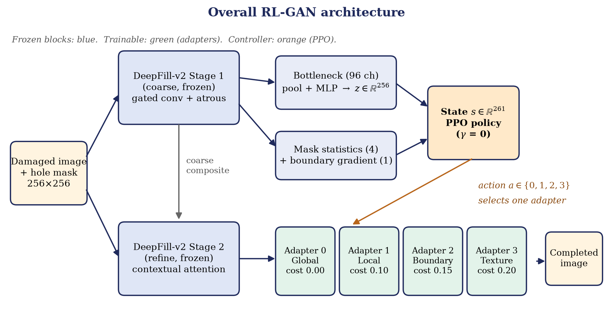

# RL-GAN Documentation

These pages explain how the RL-GAN adaptive inpainting system works, from the model structure to the training loop and the web studio.

| Page | What it explains |
|---|---|
| [GETTING_STARTED.md](GETTING_STARTED.md) | Setup, downloads and the commands to run the whole pipeline |
| [ARCHITECTURE.md](ARCHITECTURE.md) | The model: frozen backbone, state vector, strategy adapters, data flow and code map |
| [TRAINING_AND_RL.md](TRAINING_AND_RL.md) | Adapter pretraining, the contextual-bandit environment, the reward and PPO |
| [EVALUATION.md](EVALUATION.md) | The four-stage evaluation, metrics, severity buckets and results |
| [WEB_STUDIO.md](WEB_STUDIO.md) | The interactive studio: user interface, HTTP API and request flow |

The written project report is available as [RL_GAN_Inpainting_Report.pdf](RL_GAN_Inpainting_Report.pdf) (Word version: [RL_GAN_Inpainting_Report.docx](RL_GAN_Inpainting_Report.docx)).

## The idea in one picture

A damaged image and its hole mask go through a frozen DeepFill-v2 generator. A small 261-number state is built from the backbone's own features plus a few mask descriptors. A PPO agent reads that state and picks one of four specialised adapters (Global, Local, Boundary, Texture). The chosen adapter refines the backbone output, and only the hole region of the result is written back into the image.
