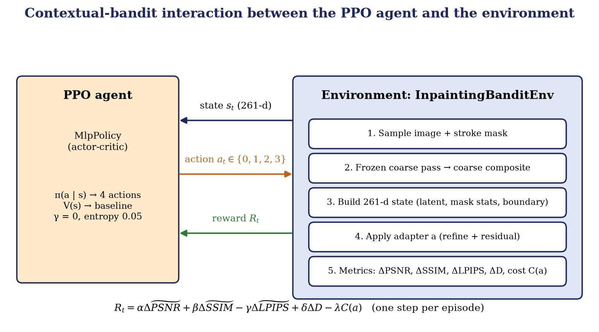

# Training and Reinforcement Learning

Training has two stages that never update the backbone: first the adapters learn their specialities, then a PPO agent learns which adapter to use.


## 1. Stage 1: adapter pretraining

`python main.py pretrain-adapters --config configs/pretrain_adapters.yaml` (`src/training/pretrain_adapters.py`)

* **Data.** COCO val2017 images resized to 256×256 with random irregular stroke masks (1–4 strokes of random width and length, occasionally a circle) generated on the fly by `src/data/mask_generator.py`.
* **Procedure.** For every batch the frozen backbone computes the coarse composite and the refined image. Each adapter in turn receives the refined image, is composited into the hole, and is trained with **its own loss**:

| Adapter | Loss |
|---|---|
| Global | L1(hole) + L1(valid) + VGG-16 perceptual loss (`PerceptualAndStyleLoss`, weight 0.05) |
| Local | 6·L1(hole) + 0.2·L1(valid) + 0.5·SSIM-style term (L1 between 11×11 box-filtered means inside the hole) |
| Boundary | L1(hole) + L1(valid) + 2·Sobel-gradient L1, weighted 2.0 on the hole-boundary ring and 0.2 elsewhere |
| Texture | L1(hole) + L1(valid) + 0.1·L1 between FFT magnitudes + VGG perceptual loss |

* **Optimiser.** Adam, learning rate 1e-4, betas (0.5, 0.999), batch size 4, 5 epochs.
* **Output.** `checkpoints/adapters/adapters_epoch_XXX.pt` and `adapters_final.pt` (adapter weights, strategy embeddings, encoder head).

Different losses pull each adapter toward a different behaviour: Local concentrates on hole fidelity, Boundary on edge continuity at the seam, Texture on high-frequency detail, Global on a balanced reconstruction.

### Strategy verification gate

`python main.py verify-strategies ...` applies the four adapters to the same coarse composite of several images, prints per-strategy PSNR/SSIM and checks that no single strategy wins more than 80 % of the images. It also prints the pairwise distance between state embeddings and a four-action reward sanity check, and writes comparison grids to `results/strategy_verify/`.

## 2. Stage 2: PPO contextual bandit

`python main.py train-rl --config configs/rl_agent_bandit.yaml` (`src/training/train_rl_bandit.py`)

### 2.1 The bandit formulation



Each image needs one decision and the quality of the result is known immediately, so every episode has exactly **one step** and the discount factor is **γ = 0**:

* **State** – the 261-dimensional observation (see [ARCHITECTURE.md](ARCHITECTURE.md)).
* **Action** – `Discrete(4)`: 0 Global, 1 Local, 2 Boundary, 3 Texture.
* **Reward** – measured improvement of the adapter result over the coarse composite (below).

`src/rl/env_bandit.py` (`InpaintingBanditEnv`, a Gymnasium environment) does the following in `reset()`: sample an image and stroke mask, run the coarse pass, record the coarse metrics and discriminator score, and build the state. In `step(action)`: apply the chosen adapter, composite into the hole, measure PSNR, SSIM, LPIPS and the discriminator confidence, compute the reward, and draw the next sample.

### 2.2 The reward

```
R = α·ΔPSNR~ + β·ΔSSIM~ − γ·ΔLPIPS~ + δ·ΔD − λ·C(a)
```

| Term | Definition |
|---|---|
| ΔPSNR~ | clip((PSNR_refined − PSNR_coarse) / 10, ±2) |
| ΔSSIM~ | clip((SSIM_refined − SSIM_coarse) / 0.1, ±2) |
| ΔLPIPS~ | clip((LPIPS_refined − LPIPS_coarse) / 0.1, ±2) (lower is better, hence subtracted) |
| ΔD | change in the mean patch confidence of the spectral-normalised PatchGAN discriminator |
| C(a) | action cost: 0.00 / 0.10 / 0.15 / 0.20 |

The weights `(α, β, γ, δ, λ) = (1.0, 1.0, 0.5, 0.3, 0.1)` come from `configs/rl_agent_bandit.yaml`, and the total reward is clipped to ±10. Normalising each delta stops PSNR from dominating the other terms.

### 2.3 PPO

Stable-Baselines3 `PPO("MlpPolicy", ...)` with these settings:

| Setting | Value |
|---|---|
| Discount γ | 0.0 |
| Rollout length `n_steps` | 128 |
| Mini-batch / epochs | 32 / 4 |
| Learning rate | 3e-4 |
| Entropy coefficient | 0.05 |
| Value-loss coefficient / max grad-norm | 0.5 / 0.5 |
| Seed | 42 |
| Timesteps | 5000 in the config; `--timesteps` overrides it |

During PPO training the backbone and the adapters are frozen. A callback logs the action distribution and every reward component to TensorBoard (`logs/rl_agent_bandit/`). The trained policy is saved as `checkpoints/rl_agent_bandit/ppo_bandit_final.zip`.

### 2.4 Using the policy

At inference, `PPO.predict(state, deterministic=True)` returns the action. The web studio, the ablation script and the evaluators all build the same 261-d state and then call `generator.refine(coarse_composite, mask, strategy=action)`.

## 3. Reproducibility

`src/utils/seed.py` seeds Python, NumPy and PyTorch (including cuDNN determinism). Fixed evaluation masks are generated from a seeded generator (seed 42) so every experiment uses the same masks.
