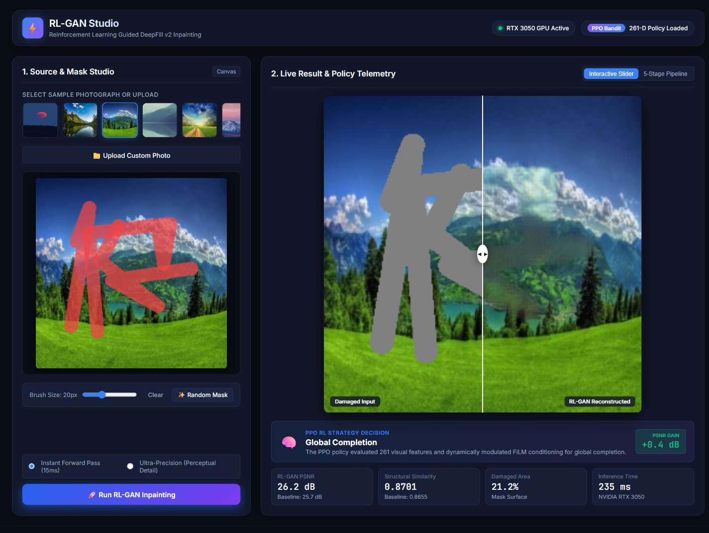
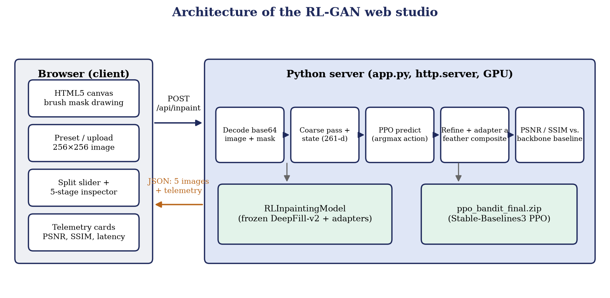

# Web Studio

The web studio (`app.py` + `web/`) lets you draw a mask on a photograph and see the RL-GAN pipeline inpaint it, together with the strategy the PPO agent chose and live quality numbers.

```powershell
python app.py            # serves http://localhost:7860 (optional argument: port)
```



## 1. User interface

| Area | What it does |
|---|---|
| Preset bar / **Upload Custom Photo** | Choose one of the sample photographs in `data/raw/sample_images` or upload an image (resized to 256×256) |
| Canvas | Paint the hole with the brush (size slider 6–48 px); **Clear** removes the mask and **Random Mask** draws organic strokes |
| Mode switch | *Instant Forward Pass* (one pass through the model) or *Ultra-Precision* (adds a short per-image refinement, see below) |
| **Run RL-GAN Inpainting** | Sends the image and mask to the server |
| Result panel | Before/after **split slider**, and a **5-stage pipeline** tab showing ground truth, masked input, coarse result, backbone baseline and RL-GAN output |
| Decision card | Name of the strategy the PPO agent picked and the PSNR gain over the baseline |
| Telemetry cards | PSNR, SSIM (with baseline values), damaged-area percentage, inference time and GPU name |

## 2. Request flow



1. The browser sends `POST /api/inpaint` with the 256×256 image and the mask, both as base64 PNG data URLs.
2. The server decodes them, thresholds the mask (luminance above 30 means hole) and builds `masked = image · (1 − mask)`.
3. It runs the coarse pass and extracts the 261-d state (latent, mask statistics from `compute_mask_stats`, boundary gradient).
4. `rl_agent.predict(state, deterministic=True)` returns the action. If the request contains an `action` field (0–3) that value is used instead; if no PPO file is present the server uses action 1.
5. It computes the backbone-only baseline (`strategy=None`) and the adapter result, blends the result with a feathered mask (`feather_composite`), and measures PSNR and SSIM of both against the original image.
6. It returns a JSON document.

### Endpoints

| Method and path | Purpose |
|---|---|
| `GET /` | Static front end from `web/` |
| `GET /api/presets` | List of sample images `[{name, url}]` |
| `GET /api/image/<name>` | A sample image resized to 256×256 (JPEG) |
| `POST /api/inpaint` | Run inpainting |

`POST /api/inpaint` request body:

```json
{ "image": "data:image/png;base64,...", "mask": "data:image/png;base64,...",
  "mode": "fast", "action": 2 }
```

`mode` is `"fast"` or `"precision"`; `action` is optional.

Response (abridged):

```json
{ "action_id": 0, "action_name": "Global Completion", "result_mode": "PPO",
  "rl_agent_available": true, "elapsed_ms": 235,
  "psnr_base": 25.7, "ssim_base": 0.8655, "psnr_rl": 26.2, "ssim_rl": 0.8701,
  "delta_psnr": 0.4, "delta_ssim": 0.0046,
  "stats": { "missing_ratio": 21.2, "num_regions": 0.1 },
  "images": { "ground_truth": "data:image/png;base64,...", "masked": "...",
              "coarse": "...", "baseline": "...", "rl_inpainted": "..." } }
```

## 3. The two modes

* **Instant Forward Pass (`fast`).** One coarse pass, one state extraction, one PPO decision and one refine + adapter pass. On the RTX 3050 used for development a request took about 235 ms once the GPU was warm (the first request also pays for CUDA start-up). The time includes the extra backbone-only baseline pass and the PSNR/SSIM computation.
* **Ultra-Precision (`precision`).** After the PPO decision the server takes 60 AdamW steps (lr 3e-4) on the chosen adapter, minimising a hole-weighted L1 loss against the original image, produces the result, and then restores the original weights so the next request starts from the trained model. Because the original image is the target, this mode shows how closely an adapter can fit a particular image.

## 4. Files

| File | Role |
|---|---|
| `app.py` | Model loading at start-up, HTTP handler, inference code |
| `web/index.html` | Page layout |
| `web/style.css` | Dark interface styling |
| `web/app.js` | Canvas drawing, mask export, API call, slider and telemetry updates |
